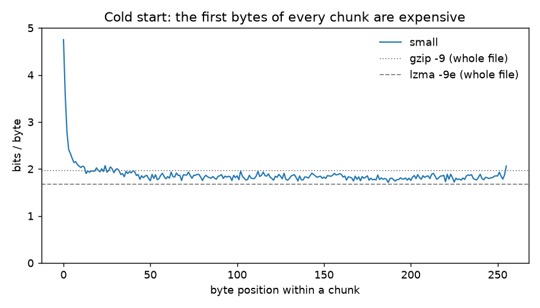

# Neural compression from scratch

*Language modelling is compression*, made concrete and verified byte for byte.

A model that gives the next byte probability p lets an arithmetic coder spend −log₂ p bits
on it. A model's cross-entropy is therefore a file size you can write to disk. This repo
builds that pipeline from nothing:

- **A 32-bit integer arithmetic coder**, Witten–Neal–Cleary style, with pending-bit
  underflow handling.
- **Adaptive count models.** Order-k contexts blended with PPM-C escapes; these are the
  classical baselines.
- **A byte-level transformer** that codes with an incremental KV cache. The data is either
  cut into independent chunks or coded as a few long streams with a sliding window.

It compares all of them with gzip, bz2 and lzma on held-out Python source. **Every size
reported is a real file that was decoded back and compared with the input.**

The engineering lesson is the part that bites in practice. **The encoder and decoder must
compute bit-identical probabilities**, and the same model run two mathematically
equivalent ways does not.

```
src/ncomp/
  coder.py        arithmetic encoder/decoder, deterministic frequency quantisation,
                  chunked + batched coding through one stream
  counts.py       adaptive order-k models (PPM-C blending), optional priming on train
  transformer.py  ByteGPT, KV-cache step, sliding-window streams, path-mismatch probe
  data.py         corpus: the CPython stdlib, split into train/test by file
  train.py        resumable, time-boxed training (CPU or CUDA + fp16 autocast)
  bench.py        real round trips → results/bench_*.jsonl
  report.py       results/bench.md and results/position.png
```

## Data

The corpus is the Python standard library's own `.py` files, so nothing is downloaded.
Files are assigned to train or test by a hash of their path, which puts **no file in both
splits**:

- **train:** 11,491,331 bytes;
- **test:** 593,029 bytes in 39 held-out files.

The numbers below come from CPython 3.13's `Lib`.

## Results

### Compressed size of the test set

Every coded row was decoded back and compared with the input (`results/bench.md`).

| compressor | bytes | bits / byte | vs lzma |
|---|---|---|---|
| order-0 counts, adaptive | 347,690 | 4.690 | +180.8% |
| order-2 counts, primed on train | 189,139 | 2.551 | +52.8% |
| order-2 counts, adaptive | 186,376 | 2.514 | +50.5% |
| gzip -9 | 145,413 | 1.962 | +17.4% |
| ByteGPT 128×3 (0.7M params), independent 256-byte chunks | 139,456 | 1.881 | +12.6% |
| ByteGPT 128×3, sliding window, 64 streams | **135,851** | **1.833** | +9.7% |
| order-4 counts, adaptive | 135,014 | 1.821 | +9.0% |
| lzma -9e | 123,816 | 1.670 | 0 |
| bz2 -9 | 123,739 | 1.669 | −0.1% |

The transformer here is deliberately small: 0.7M parameters, trained for 2,000 steps in
28 minutes on a laptop CPU.
- It beats gzip.
- It is close to an order-4 context model.
- It is **not** yet better than bz2 or lzma.

A larger model trained on a T4 is queued, and its results will be added here.

What the table does show:

- **The coder adds almost nothing.** For the transformer:

  | quantity | bits / byte |
  |---|---|
  | cross-entropy from the parallel forward | 1.8772 |
  | ideal code length under the quantised tables | 1.8812 |
  | actual compressed size | 1.8813 |

  So quantising probabilities to 16-bit integer frequencies costs 0.004 bits/byte
  (0.2%), and the arithmetic coder 0.0001 on top.
- **Cold starts are expensive.** The first byte of every independent chunk costs 4.75
  bits, and the model needs about 50 bytes of context to settle near 1.8. The
  *sliding-window* mode removes that: B long streams, and when a stream's KV cache
  fills it is rebuilt from [BOS] + the last ½·ctx bytes. Size drops **2.6%**, to 1.833.
  Keeping ¼ instead of ½ of the context gives 1.834, so the gain is avoiding the
  cold start, not the longer history.

  

- **Priming a count model on the training set made it slightly worse** (2.551 vs 2.514).
  With millions of training counts behind each context, the model stops adapting to the
  file in front of it. An adaptive model learns the file's local vocabulary faster
  than global statistics can teach it.

### Encoder and decoder must compute identically

The decoder recomputes every probability table from what it has decoded so far. A
single quantised frequency that differs by 1 sends it down a different interval, and
every later byte is wrong, **silently**. On the trained model:

| comparison | max abs Δp | frequency tables that differ |
|---|---|---|
| full parallel forward vs cached one-token step | 1.5e-5 | **5.2%** of positions |
| the same chunk stepped inside a batch of 64 vs alone | 3.1e-6 | **5.5%** of positions |

Both pairs compute the same mathematical function. They differ only in matmul shapes,
and therefore in floating-point reduction order.

Encoding 2,048 bytes with the full forward and decoding with the cached step goes wrong
**at byte 5**, and **90.6%** of the output is wrong. No error is raised.

So this repo's coder runs the exact same computation on both sides:
- the same path (the cached step);
- the same batch composition, since chunks are grouped identically;
- the same threads.

In practice, a file compressed on one machine is not guaranteed to decode on another
with different kernels. Production neural codecs pin their kernels or run the model in
integer arithmetic.

## Engineering notes

- **Frequency quantisation:** `f = floor(p·(2¹⁶ − 256)) + 1`, and the rounding remainder
  goes to the most likely symbol. Every byte keeps a non-empty interval, the total is
  exactly 2¹⁶, and the mapping is a pure function of the float probabilities.
- **One coded stream, many parallel chunks.** Chunks are coded in lock-step, a group at
  a time, in the order (group, step, chunk). The model runs batched, yet the output is
  still one arithmetic-coded stream.
- **The KV cache is preallocated**, of shape (B, h, ctx, d/h), and the group size is
  chosen so it fits a memory budget.
- **Bug found by the tests:** the byte values were uint8, so `sym + 1` wrapped to 0 for
  byte 255. That produced an empty interval, and the encoder's renormalisation loop
  never terminated. The encoder now rejects empty intervals explicitly.

## Run it

```
pip install -e ".[dev]"
pytest -q                                   # 23 tests
python -m ncomp.train --out results/small --d 128 --layers 3 --heads 4 --steps 2000
python -m ncomp.bench --models results/small --out results
python -m ncomp.report --out results
```
